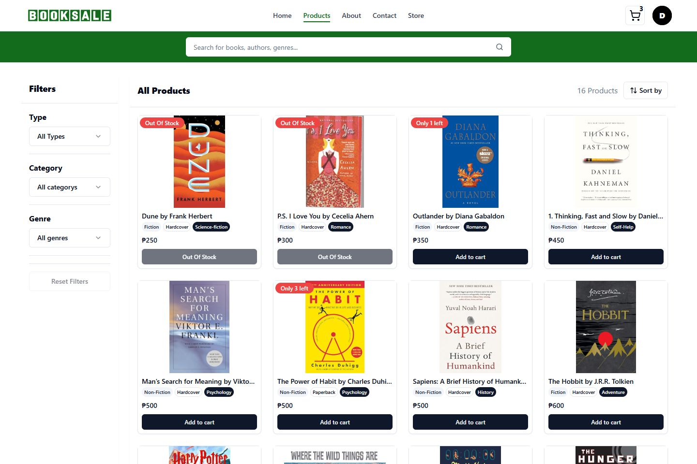
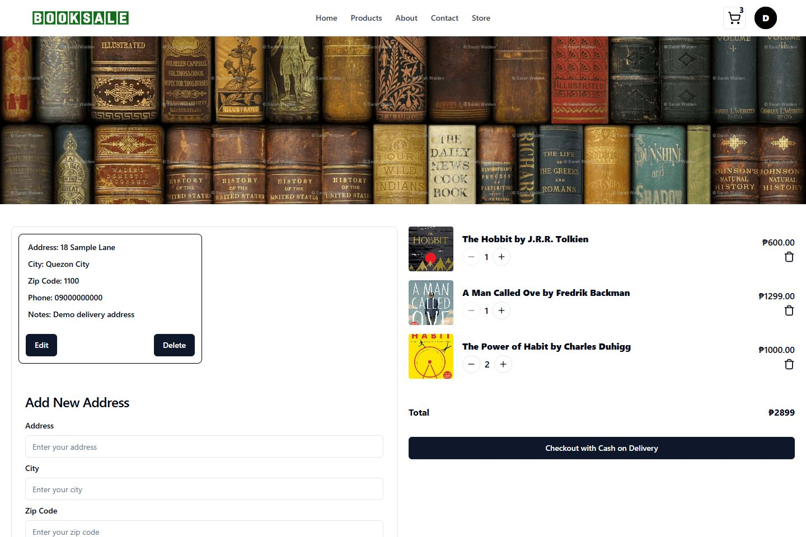
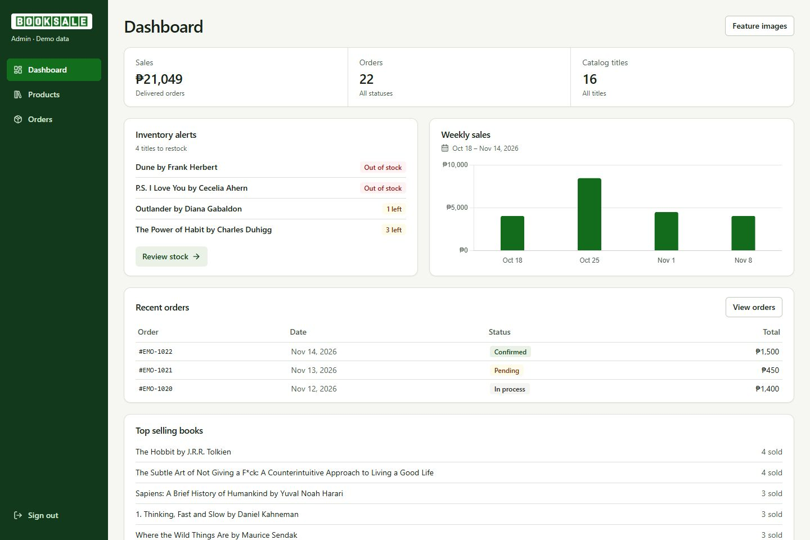

# BookSync — Online bookstore and inventory management

BookSync connects a BookSale-themed storefront with the tools staff use to run the bookstore. A reader can find a title by genre, check how many copies are left, and place a cash-on-delivery order. Staff see that order in the admin panel and can update its status as they fulfill it.

| Storefront home | Book catalog |
| --- | --- |
|  |  |
| **Cash-on-delivery checkout** | **Admin dashboard preview** |
|  |  |

The screenshots use the original 16-book catalog. Checkout shows a sample order. The dashboard previews the local BookSale redesign with synthetic sales and order data.

## Features

| For readers | For bookstore staff |
| --- | --- |
| Browse by book type, category, or genre and search for a title. | Add and edit books, cover images, prices, and stock quantities. |
| Adjust cart quantities, choose a saved delivery address, and review the total in Philippine pesos. | Open an order to review the books and delivery details, then update its fulfillment status. |
| Place a cash-on-delivery order and look it up later in the account page. | Track sales and order volume, and spot titles that are running low. |

## How it works

The React storefront and admin share one Express API and MongoDB database. When a customer confirms a cash-on-delivery order, the API saves the items and delivery address, deducts the quantities from inventory, and clears the cart. The same order then appears in the customer's history and the staff order list.

Customers can register with email and password or use Google sign-in when configured. The account's stored role determines which interface opens. The API checks the admin role before serving inventory-management and order-management requests.

## Tech stack

| Layer | Tools |
| --- | --- |
| Interface | React, React Router, Redux Toolkit, Tailwind CSS, Vite |
| API and storage | Node.js, Express, MongoDB, Mongoose |
| Authentication | bcryptjs, JWT cookies, Google Identity |
| Book cover uploads | Cloudinary |

## Run locally

You need Node.js and npm, plus a local MongoDB instance or an Atlas database you can access. Run these PowerShell commands from the repository root on a fresh clone.

```powershell
npm ci --prefix server
npm ci --prefix client
Copy-Item server/.env.example server/.env
Copy-Item client/.env.example client/.env.local
```

1. In `server/.env`, set `MONGODB_URI`. For a local database, use a URI such as `mongodb://127.0.0.1:27017/booksync`. Set `MONGODB_MANAGE_SCHEMA=true` to create collections and indexes on a fresh development database. A fresh database starts with an empty catalog.
2. Set `JWT_SECRET` in the same file. Generate a random value with `node -e "console.log(require('node:crypto').randomBytes(32).toString('hex'))"`.
3. For Google sign-in, set `GOOGLE_CLIENT_ID` on the server and `VITE_GOOGLE_CLIENT_ID` in `client/.env.local` to the same OAuth web client ID. Add `http://localhost:5173` to its authorized JavaScript origins. For new book cover uploads, fill in the three Cloudinary settings in the server template.
4. In one terminal, run `npm start --prefix server`. In another, run `npm run dev --prefix client`. Both commands run from the repository root.

Open the [local sign-in page](http://localhost:5173/auth/login). Register a customer account to visit the storefront. An existing account with the admin role opens the dashboard.

**Using the original catalog.** The original books and account roles are stored in the team's Atlas `test` database. Access requires its connection string and an allowed IP address. Keep the default `MONGODB_MANAGE_SCHEMA=false` for that database.

**Ports and checkout.** Vite runs on port 5173 and proxies `/api` to `http://127.0.0.1:5000`. If you change the server's `PORT`, update `BOOKSYNC_API_TARGET` in the client environment. A hosted frontend also needs a same-origin `/api` route. The storefront uses cash on delivery. The separate PayPal integration requires payment-provider configuration.

## Explore the code

- [Client routes](client/src/App.jsx) connect the sign-in, storefront, and admin pages.
- [Customer pages](client/src/pages/shopping-view) and [admin pages](client/src/pages/admin-view) contain the two interfaces.
- [API entry point](server/server.js) registers the routes and admin access checks.
- [Order processing](server/controllers/shop/order-controller.js) handles checkout, inventory updates, and order history.
- [Database models](server/models) define products, users, carts, addresses, reviews, and orders.
